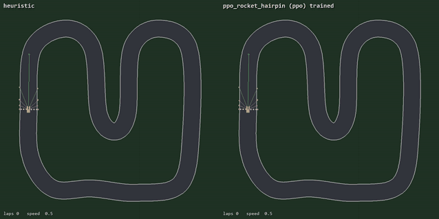

# 🏆 Challenges

Three open problems, each with an exact scoring command and a leaderboard.
Beat a record, open a PR that adds your row, and drop your agent into the
[playground](https://alperen012.github.io/Reinforcement_learning_car/web/) so others can race it.

**Rules (all challenges)**
- Score with the command given, unchanged. It uses fixed evaluation seeds the agent never trained on.
- Report the **mean over at least 3 training seeds**, not your best seed.
- Anything goes in training: algorithm, hyper-parameters, reward shaping, curriculum, network size.
  The *evaluation* environment (track, car, observation, max steps) must stay as given.
- Your PR includes: the config file, the score output, and `web/models/<you>.js` from `racing-gym export`.

---

## 1. 🚀 Rocket on the hairpin

The `rocket` car (top speed 11, grip 0.7) on `hairpin`. It understeers off the track if it
enters a corner too fast. The hand-written controller that laps every other track **crashes
every single time here**. Can learning do what three lines of control can't?

```bash
racing-gym train -c configs/challenge_rocket_hairpin.toml          # starter config
racing-gym evaluate runs/challenge_rocket_hairpin/seed0 heuristic --track hairpin --car rocket --episodes 10 --seed 1
```

Score = mean **laps** (higher is better). Ties are broken by lower crash rate.

| # | who | method | laps | crash rate | seeds | link |
|---|---|---|---:|---:|---:|---|
| — | baseline | hand-written controller | 0.00 | 100% | — | — |
| — | baseline | random actions | 0.00 | 60% | — | — |
| 1 | baseline | PPO, starter config (400k steps) | 6.00 | 0% | **1** ⚠ | `PPO rocket` in the playground |

⚠ A single training seed: the first leaderboard entry with 3 seeds takes this spot even with
equal laps.



## 2. ⚡ Fastest learner

How few environment steps until an agent drives the `classic` track **cleanly**: an
evaluation with **≥ 6 laps and 0% crashes**? Learning speed matters as soon as each
step is expensive (real robots, big simulators).

```bash
racing-gym train -c configs/<yours>.toml          # keep train.eval_freq <= 15000 so the score is precise
python scripts/first_clean_eval.py runs/<name>   # prints the first such step for each seed, and the mean
```

Score = mean over seeds of the first evaluation step that meets the bar (lower is better).

| # | who | method | steps | seeds | eval every |
|---|---|---|---:|---:|---:|
| 1 | baseline | TD3 (`configs/td3_classic.toml`) | 30,000 | 3 | 15k |
| 2 | baseline | A2C (`configs/a2c_classic.toml`) | 50,000 | 3 | 25k |
| 3 | baseline | PPO (`configs/ppo_classic.toml`) | 75,000 | 3 | 25k |
| 4 | baseline | SAC (`configs/sac_classic.toml`) | 80,000 | 3 | 15k |

## 3. 🌍 The generalist

Drive **7 tracks you have never seen** (`random:0`–`random:4`, `hairpin`, `snake`). A
hand-written controller already does this with zero crashes. The best RL agent so far
crashes in 29% of episodes. Close the gap.

```bash
racing-gym evaluate runs/<name>/seed0/final_model.zip --tracks random:0 random:1 random:2 random:3 random:4 hairpin snake --episodes 3
```

Score = **crash rate** (lower is better). Ties are broken by more laps. Do not train or
select checkpoints on these 7 tracks. That is why the command uses `final_model.zip`.

| # | who | method | crash rate | laps | seeds |
|---|---|---|---:|---:|---:|
| — | reference | hand-written controller (not RL) | 0% | 5.71 | — |
| 1 | baseline | PPO on random tracks (`configs/ppo_generalize.toml`) | 29% | 5.14 | 2 |
| 2 | baseline | PPO on `classic` only | 56% | 3.27 | 3 |

Ideas that might help: domain randomisation of the car, more lidar rays, a recurrent policy,
or reward terms that punish risky lines.

---

Baseline numbers come from [docs/results.md](docs/results.md) and the runs described there,
measured on a laptop CPU.
