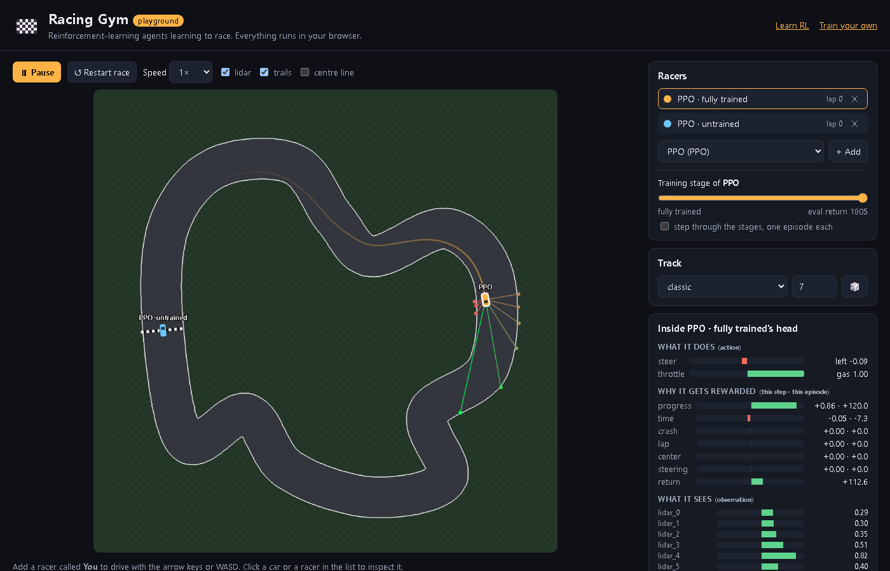
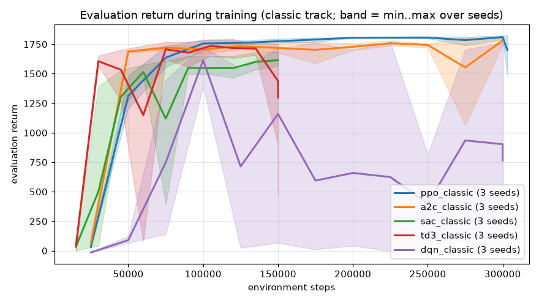
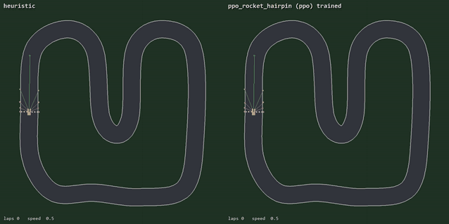

# 🏁 Racing Gym

[](https://github.com/Alperen012/Reinforcement_learning_car/actions/workflows/tests.yml)
[](LICENSE)

**Watch neural networks learn to race, then open them up and see why they drive the way they do.**

### ▶ [Try the live playground](https://alperen012.github.io/Reinforcement_learning_car/web/) · 🎓 [Train your own in Colab](https://colab.research.google.com/github/Alperen012/Reinforcement_learning_car/blob/main/notebooks/racing_gym_colab.ipynb) · 🏆 [Challenges](CHALLENGES.md)

No install needed: watch agents in the browser, or train one in Colab in 10 minutes and drop it into the playground to race it.

A small, readable reinforcement-learning playground: a 2D racing environment
(Gymnasium), five algorithms (Stable-Baselines3), and a **browser playground**
where trained agents race each other, you, and their own untrained selves.


<sub>One PPO agent at three moments of its training, on the same track. Left: 25k steps, it crashes. Middle: 50k, it drives but carefully. Right: its best checkpoint (250k of a 300k-step budget), flat out on the racing line. Trains in a few minutes on a laptop CPU.</sub>

## Why this exists

Most RL examples are either a 50-line script that prints a reward number, or
a research framework you need a week to understand. This sits in between:

* 🎮 **Play first.** Open the [live playground](https://alperen012.github.io/Reinforcement_learning_car/web/) (or `web/index.html` locally): no install, no server. Race the agents, scrub through their training, change the car's grip and watch them fail.
* 🔍 **See inside.** Every step shows *what the agent sees* (17 numbers), *what it does*, and *which reward term* paid for it.
* 🧪 **Experiment in one line.** Every reward weight, physics constant and hyper-parameter is a config value: `racing-gym train -c configs/ppo_classic.toml -s env.reward.crash=0`
* 📏 **Honest numbers.** Every comparison includes a random policy, the untrained network and a hand-written controller, over several seeds. Every result in [docs/results.md](docs/results.md) is produced by a command in this repo.
* 📖 **Readable.** Under 2,000 lines of commented Python. The car physics is one 30-line function.

## The playground



Open the **[live playground](https://alperen012.github.io/Reinforcement_learning_car/web/)**, or `web/index.html` from a clone (double-click works). Then:

* drag **Training stage** to watch the agent at any checkpoint, from untrained to its best checkpoint,
* **+ Add** racers: other agents, the hand-written controller, random actions, or **You** (arrow keys),
* **drop your own agent's file** on the track (from `racing-gym export` or the Colab notebook) and race it,
* pick a preset or a 🎲 random track (agents trained on one track struggle on others, and you can see why),
* open **Car physics** and lower the grip: *distribution shift* in action.

Deep links work too, e.g. [a random track at 2× speed](https://alperen012.github.io/Reinforcement_learning_car/web/?track=random:42&speed=2).

## Quick start (Python ≥ 3.11)

```bash
git clone https://github.com/Alperen012/Reinforcement_learning_car
cd Reinforcement_learning_car
python -m venv .venv
source .venv/bin/activate            # Windows: .venv\Scripts\activate
pip install -e .

racing-gym play --track oval                      # drive it yourself (arrow keys)
racing-gym train -c configs/quickstart.toml       # ~2 min on a laptop CPU
racing-gym watch runs/quickstart/seed0 --track oval
racing-gym evaluate runs/quickstart/seed0 heuristic untrained random --track oval
```


## What's inside

| | |
|---|---|
| **Environment** | `RacingGym-v0`, standard Gymnasium API. Continuous `[steer, throttle]` or 9 discrete actions. Egocentric 17-dim observation: 9 lidar rays, speed, wheel angle, heading error, lateral offset, curvature ahead. |
| **Tracks** | 4 presets + unlimited seeded procedural tracks (`random:<seed>`). |
| **Car** | Kinematic bicycle model with a tyre-grip limit (it understeers if you corner too fast). Presets `balanced`, `grippy`, `rocket`. Optional domain randomisation for training: `env.car_randomize = 0.2` scales grip, top speed and acceleration by a random factor in [0.8, 1.2] at every reset (evaluation always uses the nominal car). |
| **Reward** | progress along the track + time penalty + crash penalty + lap bonus (+ optional centring and smooth-steering terms). Each term is logged separately. |
| **Algorithms** | PPO, A2C, SAC, TD3, DQN via [Stable-Baselines3](https://github.com/DLR-RM/stable-baselines3). Adding one is one registry entry. |
| **Tooling** | `train` · `evaluate` · `watch` · `play` · `record` (GIFs) · `plot` (learning curves) · `export` (to the browser) · `tracks` |
| **Logging** | Per-run directory: resolved config, versions, CSV of every episode and evaluation, TensorBoard, checkpoints. |
| **Tests** | 71 pytest tests, including checks that the browser simulator and exported networks match Python step for step. |


## Results

Measured on a laptop CPU (Intel i7-11800H), 3 seeds per algorithm, on test episodes that were never
used to pick a checkpoint. Full tables, learning curves, method and the exact commands:
**[docs/results.md](docs/results.md)**.

| policy (classic track, 10 test episodes × 3 seeds) | laps in 2000 steps | crash rate | final weights: laps / crashes | train time / seed |
|---|---:|---:|---:|---:|
| random actions | 0.00 | 40% | — | — |
| hand-written controller | 5.00 | 0% | — | — |
| **PPO** (300k-step budget) | **7.00 ± 0.00** | 0% | 6.83 / 3% | 3.5 min |
| A2C (300k) | 6.70 ± 0.42 | 0% | 6.67 / 0% | 3.5 min |
| TD3 (150k) | 6.33 ± 0.47 | 0% | 4.87 / 30% | 6.4 min |
| SAC (150k) | 6.00 ± 0.00 | 0% | 6.00 / 0% | 14.6 min |
| DQN (300k, 9 discrete actions) | 6.00 ± 0.00 | 0% | 2.17 / 73% | 3.1 min |



What we read from this:

* The **best checkpoint** of every algorithm laps more than the hand-written controller without crashing.
  That is a statement about the best checkpoint, chosen on separate validation episodes.
* The **final weights** tell a different story for TD3 and DQN: their learning collapses late in training
  (DQN crashes in 73% of episodes at the end). Keeping the best checkpoint hides that instability; the
  curves show it.
* PPO and A2C, and A2C and TD3, are within one standard deviation of each other: three seeds cannot rank
  them. Budgets and action spaces differ and nothing was tuned per algorithm, so this is not a
  definitive ranking of the algorithms.
* **Generalisation:** on 7 unseen tracks, PPO trained only on `classic` crashes in 56% of episodes. Trained
  on random tracks, it crashes in 19% (3 seeds). Better, but still short of the hand-written controller (0%).
  That gap is an open problem worth working on (see the challenges).

## Learn RL with it

Fastest start: the **[Colab notebook](https://colab.research.google.com/github/Alperen012/Reinforcement_learning_car/blob/main/notebooks/racing_gym_colab.ipynb)**
(sensors → baselines → train → before/after GIF → race your agent in the browser).
Then the step-by-step path from "what is a reward?" to your own experiments:

1. [What is RL? Explained with a race car](docs/tutorials/01-what-is-rl.md)
2. [Train your first agent](docs/tutorials/02-first-agent.md)
3. [Reward design, and how agents cheat](docs/tutorials/03-reward-design.md)
4. [Comparing algorithms](docs/tutorials/04-algorithms.md)
5. [Generalisation: did it learn to drive, or memorise a track?](docs/tutorials/05-generalization.md)

## Train, evaluate, compare

```bash
racing-gym train -c configs/sac_classic.toml                         # 3 seeds
racing-gym train -c configs/ppo_classic.toml -s env.car=rocket -s name=ppo_rocket --seeds 0
racing-gym evaluate runs/ppo_classic/seed0 runs/sac_classic/seed0 heuristic --tracks classic hairpin --episodes 10
racing-gym plot runs/ppo_classic runs/sac_classic --out curves.png
racing-gym record runs/ppo_classic/seed0 runs/sac_classic/seed0 --out race.gif
racing-gym export runs/ppo_classic/seed0 --out web/models/my_ppo.js --stages 6   # appears in the playground
tensorboard --logdir runs
```

Use the environment from your own code:

```python
import gymnasium as gym
import racing_gym  # registers RacingGym-v0

env = gym.make("RacingGym-v0", config={"track": "random", "car": "rocket"})
obs, info = env.reset(seed=0)
obs, reward, terminated, truncated, info = env.step(env.action_space.sample())
print(info["reward_terms"])   # {'progress': ..., 'time': -0.05, 'crash': 0.0, ...}
```

## How it fits together

```
configs/*.toml ─► racing-gym train ─► runs/<name>/seed<k>/ ─► evaluate · watch · record · plot
                                                     └─────► export ─► web/models/*.js ─► web/index.html
```

[Architecture](docs/architecture.md) · [Design decisions](docs/decisions.md) ·
[Extending (new tracks, rewards, algorithms)](docs/extending.md) ·
[Audit of v0.1](docs/audit.md) · [Research notes](docs/research.md)

**Hardware:** everything runs on a CPU. On an 8-core laptop: PPO ~3–4 min per 300k-step seed, TD3 ~6 min
and SAC ~15 min per 150k-step seed. The playground runs in any modern browser.

## Challenges

Three open problems with fixed scoring commands and leaderboards: details in **[CHALLENGES.md](CHALLENGES.md)**.

| challenge | current best | to beat |
|---|---|---|
| 🚀 **Rocket on the hairpin**: hand-coded control crashes 100% | PPO, 6 laps / 0% crashes (1 seed) | 3 seeds, more laps |
| ⚡ **Fastest learner**: steps to a clean 6-lap drive | TD3, 30,000 steps | fewer steps |
| 🌍 **The generalist**: 7 unseen tracks | PPO, 19% crashes | lower crash rate (hand-coded: 0%) |



<sub>Where learning beats hand-coding: with the fast, low-grip `rocket` car, the hand-written controller (left) enters the hairpin too fast and crashes every time. PPO (right) learned to brake. Where hand-coding beats learning: the generalist challenge.</sub>

## Roadmap

- [x] Domain randomisation (random grip and top speed during training): `env.car_randomize`
- [ ] A robustness benchmark (evaluate with a different car than the one trained on)
- [ ] Multi-car racing with car-to-car lidar
- [ ] Track editor in the playground (click control points, export a preset)
- [ ] Recurrent policy (`sb3_contrib.RecurrentPPO`) with fewer lidar rays: memory vs perception

Ideas and contributions welcome: see [CONTRIBUTING.md](CONTRIBUTING.md).

## Citing

See [CITATION.cff](CITATION.cff).

## License

[MIT](LICENSE): use it, change it, teach with it.
