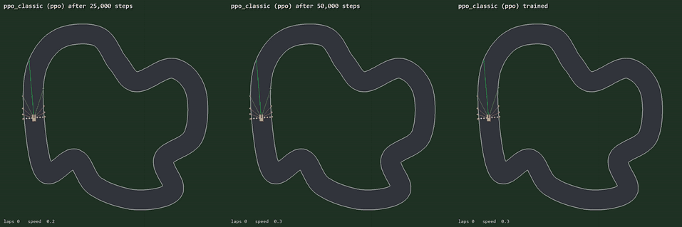
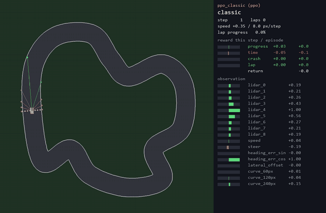
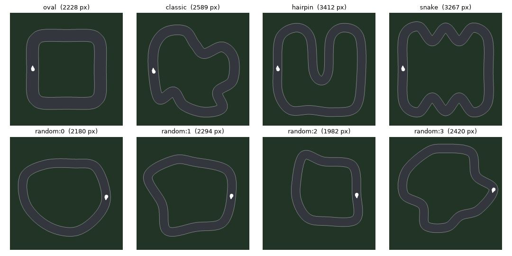

# 🏁 Racing Gym

**Watch neural networks learn to race, then open them up and see why they drive the way they do.**

A small, readable reinforcement-learning playground: a 2D racing environment
(Gymnasium), five algorithms (Stable-Baselines3), and a **browser playground**
where trained agents race each other, you, and their own untrained selves.



<sub>One PPO agent at three moments of its training, on the same track. Left: 25k steps, it crashes. Middle: 50k, it drives but carefully. Right: 300k, flat out on the racing line. Trains in 4–5 minutes on a laptop CPU.</sub>

## Why this exists

Most RL examples are either a 50-line script that prints a reward number, or
a research framework you need a week to understand. This sits in between:

* 🎮 **Play first.** Open `web/index.html`: no install, no server. Race the agents, scrub through their training, change the car's grip and watch them fail.
* 🔍 **See inside.** Every step shows *what the agent sees* (17 numbers), *what it does*, and *which reward term* paid for it.
* 🧪 **Experiment in one line.** Every reward weight, physics constant and hyper-parameter is a config value: `racing-gym train -c configs/ppo_classic.toml -s env.reward.crash=0`
* 📏 **Honest numbers.** Every comparison includes a random policy, the untrained network and a hand-written controller, over several seeds. Every result in [docs/results.md](docs/results.md) is produced by a command in this repo.
* 📖 **Readable.** ~1,500 lines of commented Python. The car physics is one 30-line function.

## The playground


Open **`web/index.html`** in a browser (double-click works). Then:

* drag **Training stage** to watch the agent at any checkpoint, from untrained to fully trained,
* **+ Add** racers: other agents, the hand-written controller, random actions, or **You** (arrow keys),
* pick a preset or a 🎲 random track (agents trained on one track struggle on others, and you can see why),
* open **Car physics** and lower the grip: *distribution shift* in action.

Deep links: `web/index.html?track=random:42&speed=2`.

## Quick start (Python ≥ 3.11)

```bash
git clone https://github.com/Alperen012/Reinforcement_learning_car
cd Reinforcement_learning_car
python -m venv .venv
source .venv/bin/activate            # Windows: .venv\Scripts\activate
pip install -e .

racing-gym play --track oval                      # drive it yourself (arrow keys)
racing-gym train -c configs/quickstart.toml       # ~2 min on a laptop CPU
racing-gym watch runs/quickstart/seed0 --track oval
racing-gym evaluate runs/quickstart/seed0 heuristic untrained random --track oval
```



## What's inside

| | |
|---|---|
| **Environment** | `RacingGym-v0`, standard Gymnasium API. Continuous `[steer, throttle]` or 9 discrete actions. Egocentric 17-dim observation: 9 lidar rays, speed, wheel angle, heading error, lateral offset, curvature ahead. |
| **Tracks** | 4 presets + unlimited seeded procedural tracks (`random:<seed>`). |
| **Car** | Kinematic bicycle model with a tyre-grip limit (it understeers if you corner too fast). Presets `balanced`, `grippy`, `rocket`. |
| **Reward** | progress along the track + time penalty + crash penalty + lap bonus (+ optional centring and smooth-steering terms). Each term is logged separately. |
| **Algorithms** | PPO, A2C, SAC, TD3, DQN via [Stable-Baselines3](https://github.com/DLR-RM/stable-baselines3). Adding one is one registry entry. |
| **Tooling** | `train` · `evaluate` · `watch` · `play` · `record` (GIFs) · `plot` (learning curves) · `export` (to the browser) · `tracks` |
| **Logging** | Per-run directory: resolved config, versions, CSV of every episode and evaluation, TensorBoard, checkpoints. |
| **Tests** | 43 pytest tests, including a check that the browser simulator matches Python step for step. |



## Results

Measured on a laptop CPU (Intel i7-11800H), 3 seeds per algorithm. Full table,
learning curves and the exact commands: **[docs/results.md](docs/results.md)**.

| policy (classic track, 10 episodes × 3 seeds) | laps in 2000 steps | crash rate | train time / seed |
|---|---:|---:|---:|
| random actions | 0.00 | 40% | — |
| hand-written controller | 5.00 | 0% | — |
| **PPO** (300k steps) | **7.00 ± 0.00** | 0% | 3.5 min |
| A2C (300k) | 6.70 ± 0.42 | 0% | 3.5 min |
| TD3 (150k) | 6.33 ± 0.47 | 0% | 6.4 min |
| SAC (150k) | 6.00 ± 0.00 | 0% | 14.6 min |
| DQN (300k, 9 discrete actions) | 4.87 ± 0.90 | 27% ± 25 | 3.1 min |


What we read from this (best checkpoint per seed; see the curves for stability):

* Every algorithm beats the hand-written controller, and PPO does so on every seed.
* Off-policy methods (TD3, SAC) need fewer environment steps but more wall-clock time. TD3's curve
  drops sharply near the end of training, a classic instability that keeping the best checkpoint hides.
* DQN with only 9 coarse actions is the least stable by far (wide band, 27% crashes).
* **Generalisation:** on 7 unseen tracks, PPO trained only on `classic` crashes in 56% of episodes. Trained
  on random tracks, it crashes in 29%. Better, but still short of the hand-written controller (0%).
  That gap is an open problem worth working on (see the roadmap).

## Learn RL with it

A path from "what is a reward?" to running your own experiments:

1. [What is RL? Explained with a race car](docs/tutorials/01-what-is-rl.md)
2. [Train your first agent](docs/tutorials/02-first-agent.md)
3. [Reward design, and how agents cheat](docs/tutorials/03-reward-design.md)
4. [Comparing algorithms](docs/tutorials/04-algorithms.md)
5. [Generalisation: did it learn to drive, or memorise a track?](docs/tutorials/05-generalization.md)

## Train, evaluate, compare

```bash
racing-gym train -c configs/sac_classic.toml                         # 3 seeds
racing-gym train -c configs/ppo_classic.toml -s env.car=rocket -s name=ppo_rocket --seeds 0
racing-gym evaluate runs/ppo_classic/seed0 runs/sac_classic/seed0 heuristic --tracks classic hairpin --episodes 10
racing-gym plot runs/ppo_classic runs/sac_classic --out curves.png
racing-gym record runs/ppo_classic/seed0 runs/sac_classic/seed0 --out race.gif
racing-gym export runs/ppo_classic/seed0 --out web/models/my_ppo.js --stages 6   # appears in the playground
tensorboard --logdir runs
```

Use the environment from your own code:

```python
import gymnasium as gym
import racing_gym  # registers RacingGym-v0

env = gym.make("RacingGym-v0", config={"track": "random", "car": "rocket"})
obs, info = env.reset(seed=0)
obs, reward, terminated, truncated, info = env.step(env.action_space.sample())
print(info["reward_terms"])   # {'progress': ..., 'time': -0.05, 'crash': 0.0, ...}
```

## How it fits together

```
configs/*.toml ─► racing-gym train ─► runs/<name>/seed<k>/ ─► evaluate · watch · record · plot
                                                     └─────► export ─► web/models/*.js ─► web/index.html
```

[Architecture](docs/architecture.md) · [Design decisions](docs/decisions.md) ·
[Extending (new tracks, rewards, algorithms)](docs/extending.md) ·
[Audit of v0.1](docs/audit.md) · [Research notes](docs/research.md)

**Hardware:** everything runs on a CPU. On an 8-core laptop: PPO ~3–4 min per 300k-step seed, SAC/TD3
~13 min per 150k-step seed. The playground runs in any modern browser.

## Roadmap

- [ ] Domain randomisation (random grip and top speed during training) and a robustness benchmark
- [ ] Multi-car racing with car-to-car lidar
- [ ] Beginner notebook (Colab) walking through tutorials 1–3
- [ ] GitHub Pages deployment of the playground
- [ ] Track editor in the playground (click control points, export a preset)
- [ ] Recurrent policy (`sb3_contrib.RecurrentPPO`) with fewer lidar rays: memory vs perception

Ideas and contributions welcome: see [CONTRIBUTING.md](CONTRIBUTING.md).

## Citing

See [CITATION.cff](CITATION.cff).

## License

[MIT](LICENSE): use it, change it, teach with it.
