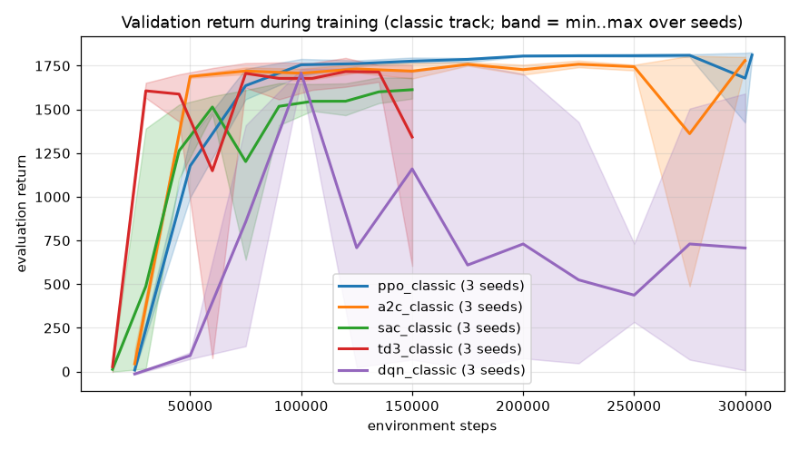

# Results

Generated by `python scripts/make_results.py` from the runs produced by `scripts/run_benchmarks.ps1`. Every number below is computed by the script.

## Method

* Hardware: Intel64 Family 6 Model 141 Stepping 1, GenuineIntel, CPU only (PyTorch CPU build).
* **Test episodes:** 10 per agent on `classic`, random start points (reset seeds 50000+), max 2000 steps, deterministic actions. Every agent and baseline drives the same episodes.
* **Checkpoint selection (validation):** during training each checkpoint drives the same evenly spread validation start points; the one with the highest validation return is kept (`best_model.zip`). Test start points are drawn so that they never coincide with a validation point, so no reported episode was used to choose a checkpoint. The track itself is the same: this table measures driving `classic` well, not generalising (see the last section).
* **Spread:** mean ± std *across training seeds* of each seed's mean.
* **Training time** was measured with two training jobs running in parallel and depends on machine load: read it as a rough cost, not a precise comparison.
* **Reproducibility:** training is deterministic on CPU. Re-running PPO (3 seeds), SAC (3 seeds) and the quickstart from scratch gave bit-identical weights.
* **Ceiling:** flat out (8 px/step) along the centre line, 2000 steps are 6.2 laps of `classic` (2589 px). Good agents do a little better by taking the inside of bends (progress is measured on the centre line). Laps are counted whole, so differences near the ceiling are coarse.

## Algorithms on the `classic` track

| policy | seeds | training budget (steps) | best checkpoint (step, per seed) | return | laps | crash rate | avg speed | laps, final weights | crash rate, final weights | train time / seed |
|---|---|---|---|---|---|---|---|---|---|---|
| random actions | — | — | — | -24.5 | 0.00 | 40% | -0.53 | — | — | — |
| untrained PPO network | — | — | — | -10.3 | 0.00 | 0% | -0.00 | — | — | — |
| hand-written controller | — | — | — | 1458.1 | 5.00 | 0% | 7.47 | — | — | — |
| **PPO** | 3 | 300,000 | 250k, 250k, 303k | 1816.3 ± 8.4 | 7.00 ± 0.00 | 0% ± 0 | 7.94 ± 0.00 | 6.83 ± 0.24 | 3% ± 5 | 3.5 min |
| **A2C** | 3 | 300,000 | 275k, 300k, 175k | 1793.7 ± 15.4 | 6.70 ± 0.42 | 0% ± 0 | 7.94 ± 0.00 | 6.67 ± 0.47 | 0% ± 0 | 3.5 min |
| **SAC** | 3 | 150,000 | 150k, 135k, 150k | 1612.7 ± 50.7 | 6.00 ± 0.00 | 0% ± 0 | 7.80 ± 0.16 | 6.00 ± 0.00 | 0% ± 0 | 14.6 min |
| **TD3** | 3 | 150,000 | 120k, 105k, 150k | 1741.8 ± 55.7 | 6.33 ± 0.47 | 0% ± 0 | 7.94 ± 0.00 | 4.87 ± 1.60 | 30% ± 42 | 6.4 min |
| **DQN** | 3 | 300,000 | 175k, 125k, 100k | 1743.3 ± 13.3 | 6.00 ± 0.00 | 0% ± 0 | 7.92 ± 0.04 | 2.17 ± 2.33 | 73% ± 38 | 3.1 min |

The first columns use each seed's best checkpoint. The *final weights* columns use the network at the end of the training budget: where they are much worse, training was unstable and the best checkpoint hides it (see the curves below).



### Reading the table

* More laps than the hand-written controller (5.00) with no more crashes: PPO, A2C, SAC, TD3, DQN. Not better: none. This is about the best checkpoint of each seed.
* With the weights left at the end of training, these crash in more than 10% of episodes: TD3 (30% crashes), DQN (73% crashes). Their learning is unstable, and keeping the best checkpoint is what makes them look good above.
* Neighbours in the ranking that differ by less than one standard deviation across seeds (treat as ties): PPO and A2C; A2C and TD3; TD3 and SAC; SAC and DQN. Three seeds cannot separate close results.
* **Not a like-for-like race.** Budgets differ (off-policy SAC/TD3 get half the steps, because each step costs more compute), DQN drives with 9 discrete actions instead of continuous ones, and every algorithm uses Stable-Baselines3 defaults plus the few settings in `configs/*_classic.toml`: nothing was tuned per algorithm. Tuned, they could rank differently.

### Did checkpoint selection overfit?

Return of the selected checkpoint on its validation episodes vs on the test episodes (mean over seeds). A large negative gap would mean checkpoints were chosen for luck on the validation start points.

| algorithm | validation return | test return | gap |
|---|---|---|---|
| PPO | 1816.1 | 1816.3 | +0.2 |
| A2C | 1792.9 | 1793.7 | +0.8 |
| SAC | 1613.7 | 1612.7 | -1.1 |
| TD3 | 1742.4 | 1741.8 | -0.6 |
| DQN | 1743.3 | 1743.3 | -0.0 |

## Generalisation

Evaluated on tracks never used for training or validation: `random:0`, `random:1`, `random:2`, `random:3`, `random:4`, `hairpin`, `snake` (3 episodes each). Training uses procedural tracks with seeds of 1000 and above; validation used `random:500`, `random:501`, `random:502`, `random:503`, `classic` (disjoint from the test tracks; checked by the script). "Final weights" involve no checkpoint choice at all.

| policy | laps | laps incl. partial | crash rate |
|---|---|---|---|
| hand-written controller | 5.71 | 6.25 | 0% |
| PPO trained on `classic` only, final weights (3 seeds) | 3.27 ± 1.83 | 3.76 ± 1.96 | 56% ± 30 |
| PPO trained on random tracks, final weights (3 seeds) | 5.57 ± 0.61 | 6.04 ± 0.64 | 19% ± 13 |
| PPO trained on random tracks, best checkpoint (3 seeds) | 5.57 ± 0.51 | 6.04 ± 0.55 | 21% ± 11 |

## Reproduce

```bash
pip install -e .
./scripts/run_benchmarks.ps1   # or run the `racing-gym train -c configs/<name>.toml` lines by hand
python scripts/reselect_best.py runs/<name>   # only for runs trained before v0.3
python scripts/make_results.py
```
